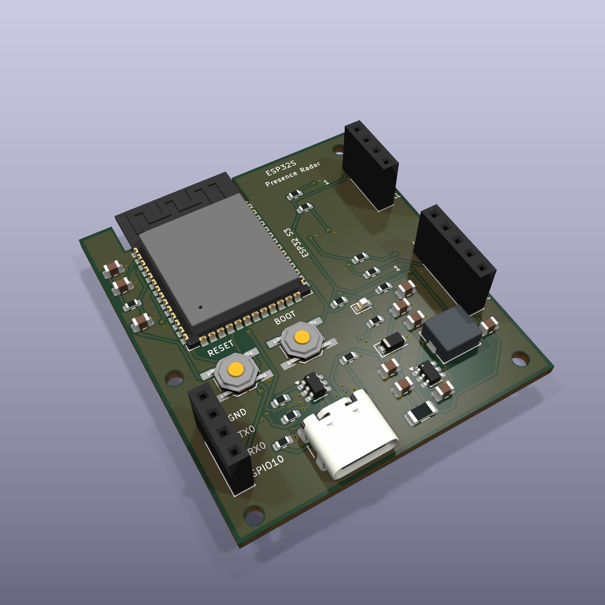
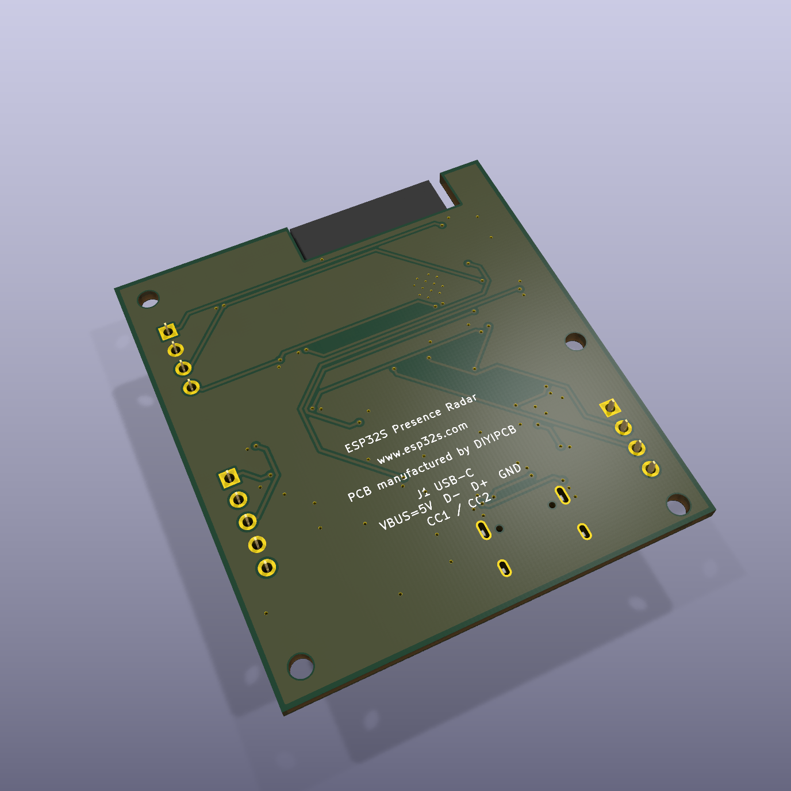
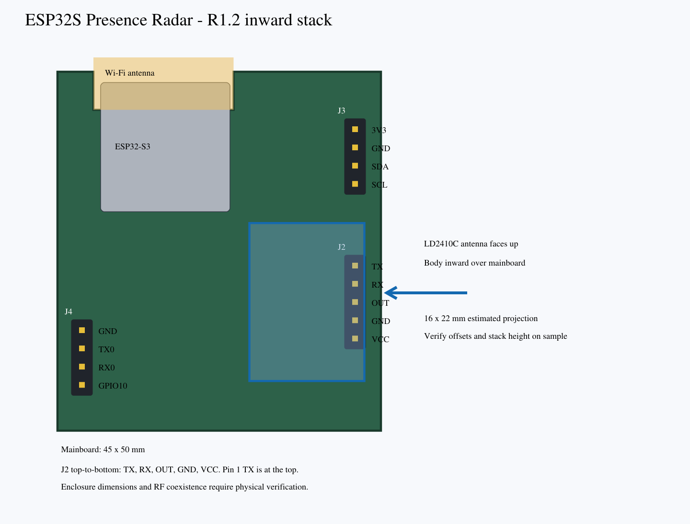

# ESP32S Presence Radar

**[Buy on ESP32S — USD $29 per kit](https://esp32s.com/product/esp32s-presence-radar/)** · [Product Wiki](https://esp32s.com/wiki/esp32s-presence-radar/)

Kit: assembled ESP32-S3 mainboard + HLK-LD2410C radar + matching cable. No enclosure, USB cable or power adapter. Made to order: 5-day production lead time after order/payment confirmation; dispatch after production and checks. Shipping time is additional.

## Latest hardware: R1.2 inward-stacked female sockets

J2, J3 and J4 are now 2.54 mm female sockets. J3 is upper-right; J2 is lower-right. Viewed from the mainboard component side, **J2 top-to-bottom is TX, RX, OUT, GND, VCC**: pin 1 TX at the top, pin 5 VCC at the bottom.

The intended direct-plug arrangement keeps the LD2410C antenna face up and its body inward above the mainboard. The PCB remains 45 × 50 mm. The module envelope is intended to stay within this footprint; exact pin offsets, insertion depth, socket height, component clearance and enclosure dimensions require sample verification. This supersedes the unpublished outward socket layout. Electrical pin definitions and firmware rules are unchanged.

Mainboard pictures are KiCad 3D renders, not product photographs. The radar outline is an estimated 16 × 22 mm projection with assumed centred pins, not a precise assembly model. Neither image certifies mechanical fit or RF coexistence.

## Download and edit

**[Latest complete R1.2 design archive](ESP32S-Presence-Radar-R1.2-45x50-stacked.zip)** ([direct download](https://github.com/DIYIPCB/ESP32S-Presence-Radar/raw/refs/heads/main/ESP32S-Presence-Radar-R1.2-45x50-stacked.zip)) · [Revision notes](REVISION-R1.2.txt)

Unpack and open `presence-radar-csi-45x50-stacked/presence_radar_csi_r1.kicad_pro` in KiCad 10. The complete archive preserves project paths and includes schematic, PCB, local symbol/footprint libraries, BOM, connectivity, Gerbers/drill/placement, previews, current analysis reports and original software examples. Standard KiCad 10 3D models must be installed. Manufacturer datasheets are linked, not redistributed.

[Earlier R1 pin-header design](ESP32S-Presence-Radar-open-source.zip) is retained as a historical source archive. Use R1.2 for the current female-socket product layout.

## Hardware and interfaces

ESP32-S3-WROOM-1-N8R8 with integrated Wi-Fi antenna; 45 × 50 mm two-layer 1.6 mm FR-4 mainboard; USB-C 5 V input/data; 3.3 V buck supply; RESET/BOOT buttons; status LED. No battery or charging management.

| Interface | Pins |
| --- | --- |
| J1 USB-C | VBUS 5 V; D− GPIO19; D+ GPIO20; GND; CC1/CC2 pulldowns |
| J2 radar female socket | 1 TX → GPIO5; 2 RX ← GPIO4; 3 OUT → GPIO6; 4 GND; 5 VCC 5 V |
| J3 I²C female socket | 1 3V3; 2 GND; 3 GPIO8 SDA; 4 GPIO9 SCL |
| J4 debug female socket | 1 GND; 2 GPIO43 TX0; 3 GPIO44 RX0; 4 GPIO10 |

J2 TX/RX names follow the radar; J4 TX0/RX0 follow the ESP32. Radar UART: 256000 baud, 3.3 V logic. SW1 RESET controls EN; SW2 BOOT controls GPIO0. Match all five signals before inserting or powering the radar. The matching cable supports optional remote mounting.

## Software, validation and limitations

R1.2 is an engineering prototype; hardware has not been powered on or qualified. Current ERC, DRC, unconnected and schematic/PCB parity checks are all zero. EMC/USB return-path risks remain in the reports; thermal analysis is SKIPPED. Prior ideal reset-RC simulation and six Python fusion-rule tests are reused because those circuits/rules are unchanged.

Radar is the primary sensing source. Full Wi-Fi CSI firmware is not implemented. The archive contains an uncompiled radar-only ESPHome configuration, a secrets template and a Python fusion-rule reference, not ready-to-use combined radar/CSI firmware. CSI needs suitable Wi-Fi traffic and environmental calibration; see [Espressif ESP-CSI](https://github.com/espressif/esp-csi).

Check socket fit, insertion height, enclosure clearance, supply ripple, USB enumeration, EMC/ESD and radar false triggers while Wi-Fi/CSI are operating. Upward antennas and greater separation do not prove interference-free operation or sensing accuracy.

## Licence

Original hardware/manufacturing data: [CERN-OHL-P-2.0](CERN-OHL-P-2.0.txt). Original code, documentation and renders: [MIT](MIT.txt). Redistributed KiCad libraries retain [CC-BY-SA-4.0](CC-BY-SA-4.0.txt) and the [KiCad library exception](KICAD-LICENSE.md). Full notices are inside the design archive.

ESP32S · www.esp32s.com · PCB manufactured by DIYIPCB. Brand markings are not evidence that hardware has been manufactured; no trademark rights or third-party endorsement are granted.
